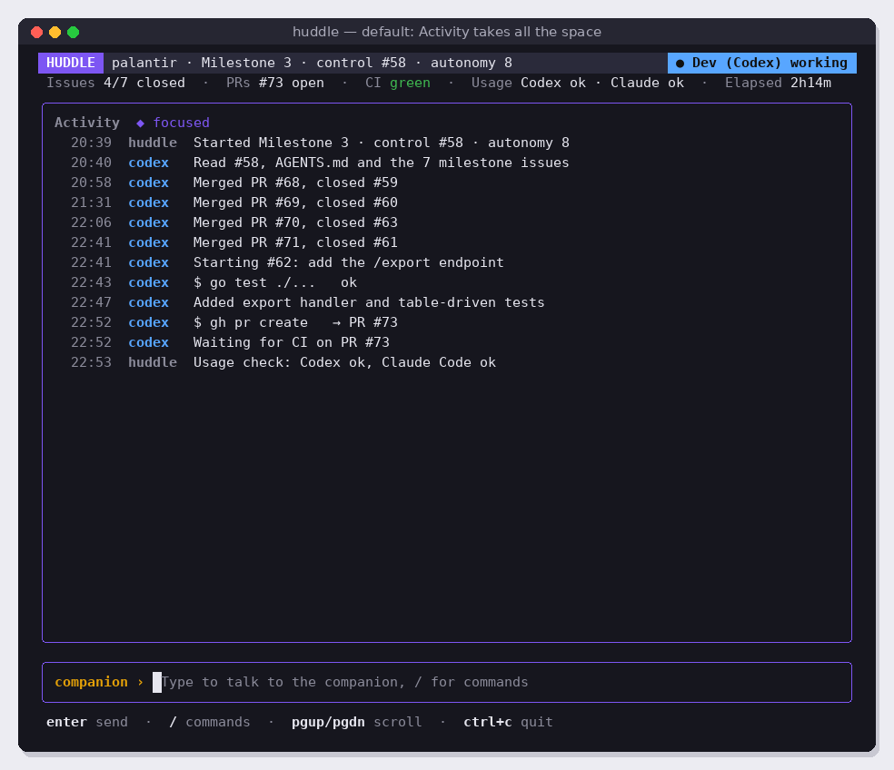
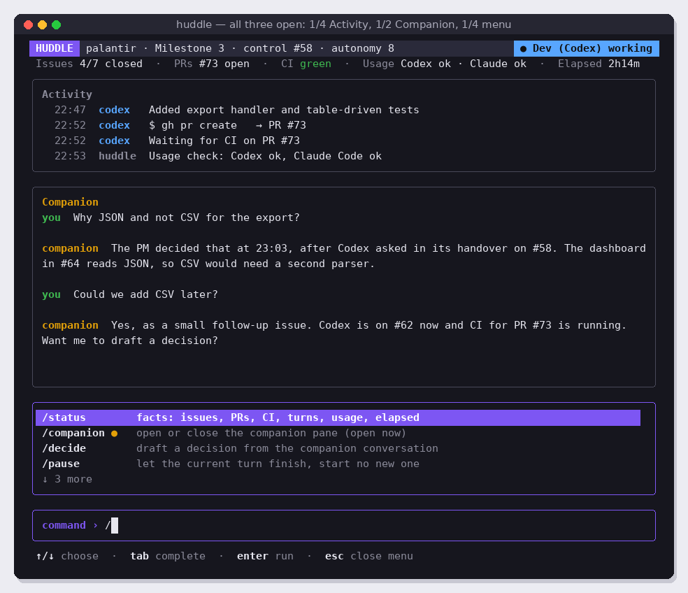
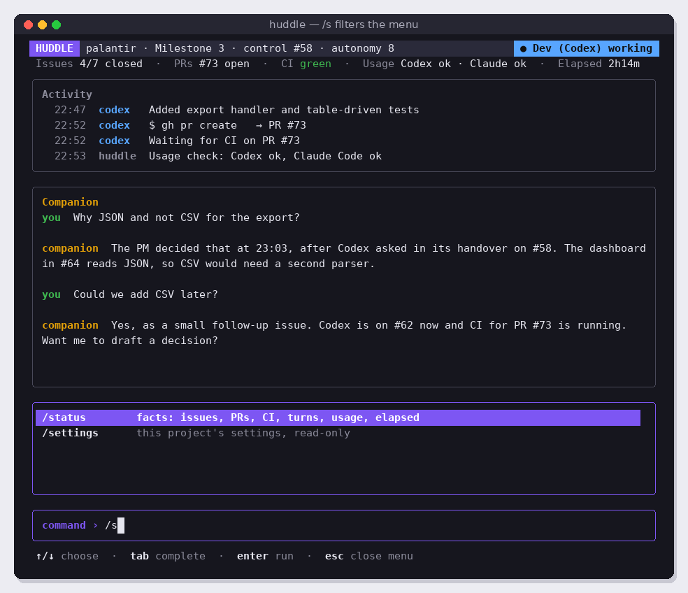
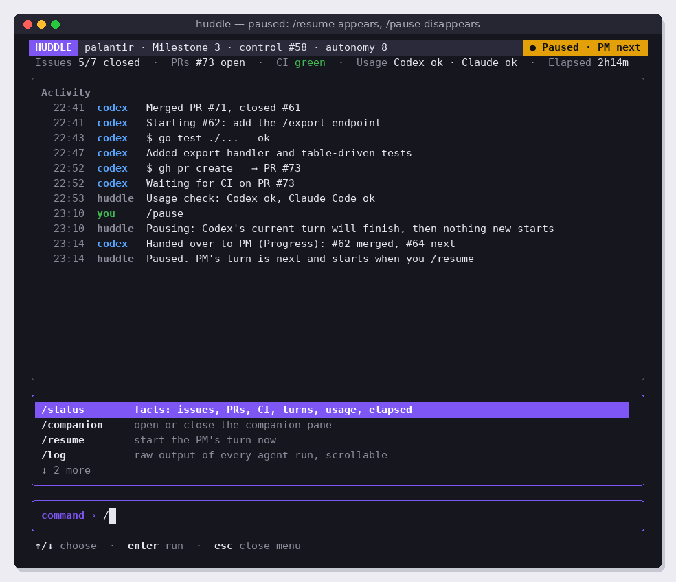
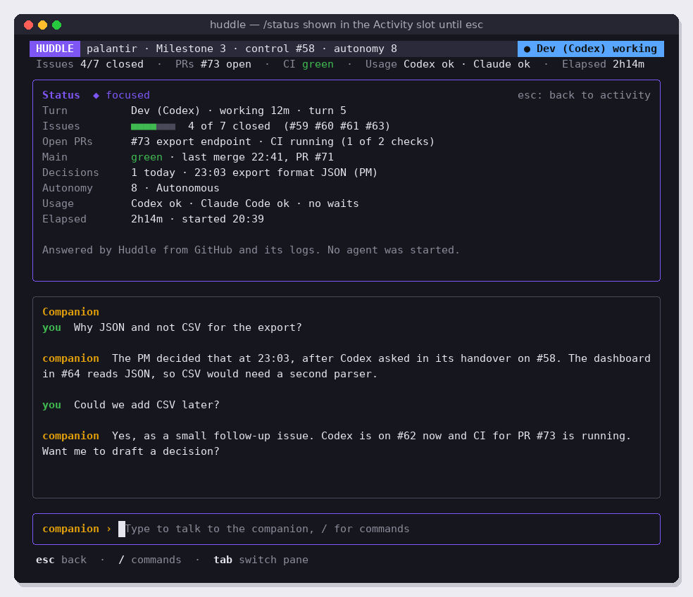
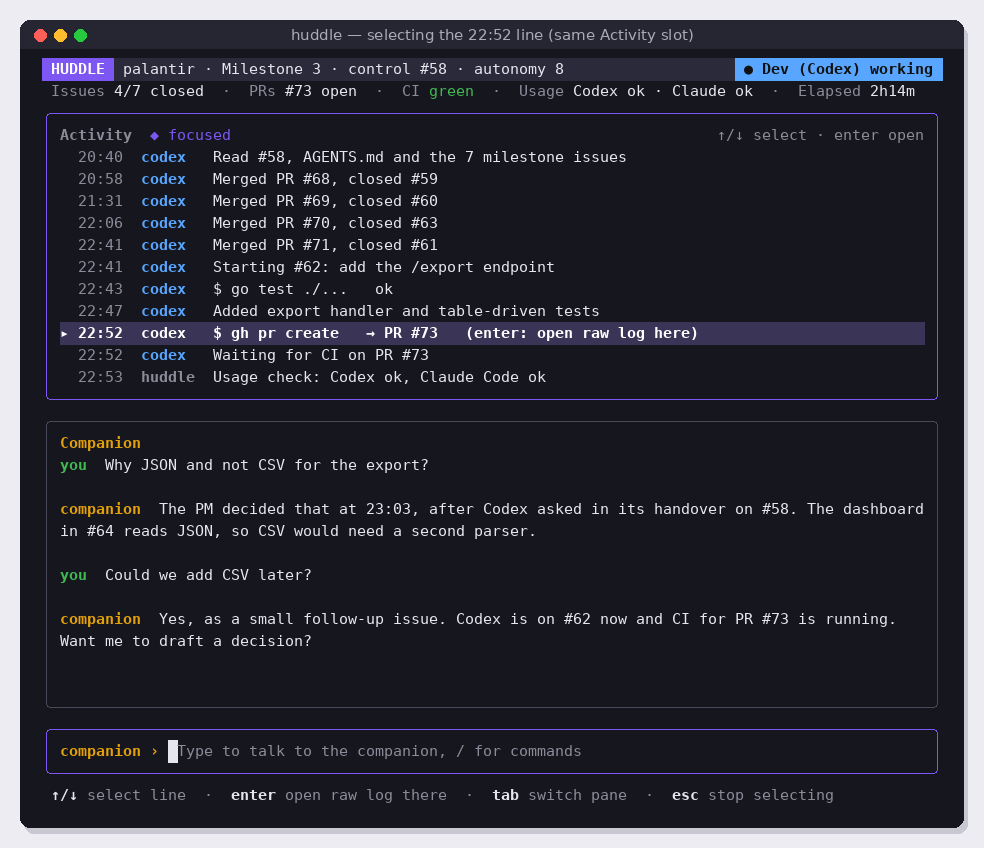
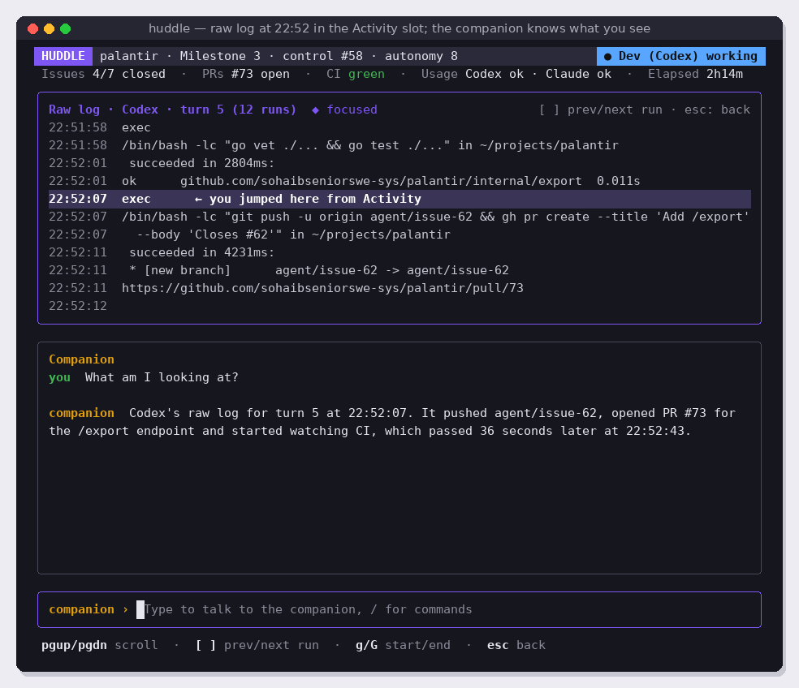

# v3.1 TUI shell

Replace Huddle's scrolling terminal output with a full-screen Bubble Tea application that shows the run in a fixed layout: project pane, Activity slot, slash-command menu, text field and help line. The loop itself (labels, turns, anti-stall, usage waits, escalation) does not change.

Read [README.md](../README.md) (layout, focus, commands) and [coding-guidelines.md](../coding-guidelines.md) first.

## Screens

Activity alone (the default):



Typing `/` opens the menu; typing more filters it:





Paused, with a context-aware menu (`/resume` shown, `/pause` hidden):



`/status` inside the Activity slot:



Selecting an Activity line, then opening the raw log at that moment:





The Companion pane appears in some screens; it is built in v3.2. In this issue the layout must already support it (see Layout), but `/companion` only says "The companion arrives in v3.2".

## What to build

### 1. Events from the loop

Today the loop prints directly to the terminal. Change it to report what happens as **events**, so the UI can show them:

```go
// Event is one line in the Activity pane. It lives in internal/activity.
type Event struct {
	Time   time.Time
	Actor  string     // "codex", "claude", "pm", "dev", "huddle" or "you"
	Text   string     // one short line, e.g. "Merged PR #71, closed #61"
	LogRef LogRef    // where this moment is in the raw log, if any
}
```

- The loop runs in its own goroutine and sends events to the Bubble Tea program with `p.Send(...)`. Comment why: Bubble Tea's `Update` must stay the only place that changes UI state.
- Keep a **`--plain`** flag that prints events as plain lines to stdout instead of starting the UI (same text as v1). Useful for tests, CI and piping into files.
- `internal/activity` turns raw agent output into events. Start simple and readable:
  - Codex: each `codex` message paragraph becomes one event (first sentence, trimmed); each `exec` command becomes `$ <command>` with `ok` or the exit code when it finishes. Skip the repeated `diff --git` blocks.
  - Claude Code: the `result` text's first sentence becomes one event.
  - Huddle's own events (turn started, label changed, usage wait, escalation) are events with actor `huddle`.
- `LogRef` records the log file and byte offset of the line the event came from, so `/log` can open there.

### 2. Layout

Implement the fixed stack and split rules from the README exactly, in one small, well-commented function:

```go
// split returns how many rows Activity, Companion and the slot get.
func split(flexRows int, companionOpen, slotOpen bool) (activity, companion, slot int)
```

- Recompute on every `tea.WindowSizeMsg`.
- Below 80 × 24, render only "Terminal too small: 80 × 24 needed".
- Use `bubbles/viewport` for every scrollable pane, `bubbles/textinput` for the text field.
- The status bar badge reflects state: `Dev (Codex) working` (blue), `PM (Claude) working`, `Waiting for you` (amber), `Paused · PM next` (amber), `Waiting for usage reset · 03:45` (amber), `Done` (green).
- The info line shows issues closed/total, open PRs, CI on main, usage per agent, elapsed time. Refresh GitHub facts at most every 60 seconds and after every turn.

### 3. Focus and keys

Implement the focus table from the README. In this issue focus can be: text field, menu, Activity. Keys go only to the focused element. Tab moves between text field and Activity. Mouse support with `tea.WithMouseCellMotion()`: wheel scrolls the pane under the pointer, click focuses Activity or selects a line.

### 4. Activity views

The Activity slot has these views; Esc always returns to the list:

| View | Opened by | Content |
| --- | --- | --- |
| List | default | Events, newest at the bottom, follows new events unless scrolled up |
| Select | ↑/↓ while Activity is focused | Same list with one highlighted line; Enter opens Log at its `LogRef` |
| Status | `/status` | Facts: turn, issues with a bar, open PRs and CI, main, decisions, autonomy, usage, elapsed. Built from GitHub and Huddle's state only; never starts an agent. |
| Log | `/log` or Enter on a line | Raw output of agent runs with timestamps per line. `[` and `]` switch runs, `g` / `G` jump to start or end. Read from the existing log files; for long files load lazily. |

### 5. Slash commands

Build `internal/commands`: the command list, prefix filtering, and visibility rules from the README. In this issue implement `/status`, `/pause`, `/resume`, `/log`, `/quit`, and a placeholder `/companion`. Also a temporary **`/reply <text>`**: while the state is `state:human-required`, it posts `<text>` as your comment on the control issue and sets `state:pm-ready`. v3.2 removes it.

- Plain text (no `/`) is never posted anywhere. Until v3.2, show "The companion arrives in v3.2; use /reply to answer the PM".
- `/pause`: Huddle finishes the current turn normally and then does not start the next one. It never kills an agent. Show it in the badge and as a `huddle` event.
- `/quit` and Ctrl+C: kill the running agent's process group, put its ready label back (as v1 does), restore the terminal, exit.

### 6. Startup

The existing startup checks still run first and print as today. Then the UI starts (unless `--plain`).

## Out of scope

The companion, decisions and cards (v3.2), `/settings` (v3.3), the wizard (v3.4), start menu (v3.6).

## Success criteria

- [ ] `huddle` opens the full-screen UI after the startup checks; `huddle --plain` behaves like v1.
- [ ] The layout matches screens 01, 03, 04, 05, 06, 07 and 08 at 100 × 34 (ignoring the Companion pane, which arrives in v3.2). Golden-file tests cover the list, menu, filtered menu, paused, status, select and log views.
- [ ] `split()` has table tests for all four combinations and odd heights; the project pane, text field and help line never change height.
- [ ] Update tests prove keys reach only the focused element: arrows in the text field never move the Activity selection, and vice versa.
- [ ] The menu filters by prefix and hides commands that don't apply (tests for running, paused and human-required states).
- [ ] Enter on an Activity line opens the Log view at that line (test with a fake log file).
- [ ] `/pause` lets the current turn finish and starts no new one; `/resume` starts it (tests with a fake runner).
- [ ] Mouse wheel scrolls the pane under the pointer (Update test with `tea.MouseMsg`).
- [ ] Manual check: a full Sandbox milestone runs to `state:done` inside the UI, and `/status`, `/log`, `/pause`, `/resume` and `/quit` behave as described.
- [ ] Code follows [coding-guidelines.md](../coding-guidelines.md); the Bubble Tea message flow is explained in comments in `internal/app`.
