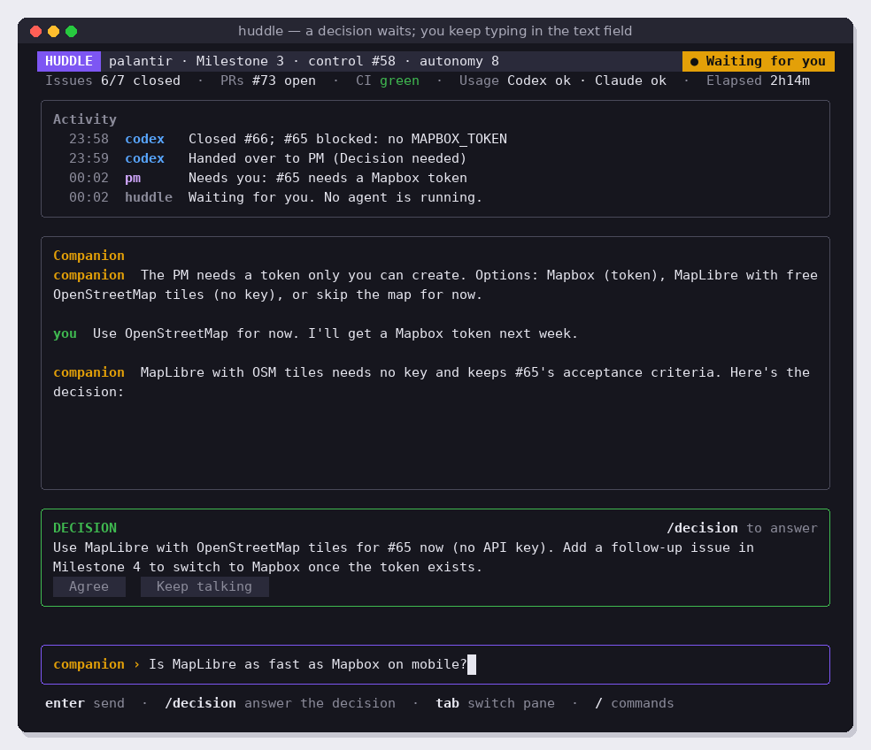

# v3.2 Companion and decisions

Add the companion: a third agent you talk to in its own pane while the Dev and PM work. It knows everything about the run and what is on your screen, never changes anything itself, and turns what you agree into decisions that Huddle posts on the control issue and hands to the PM. Depends on v3.1.

Read [README.md](../README.md) (layout, focus, commands) and [coding-guidelines.md](../coding-guidelines.md) first.

## Screens

Companion open, taking half of the middle:


All three open: ¼ Activity, ½ Companion, ¼ menu:


The companion answers from what you are looking at:


A decision waits while you keep typing; after `/decision` the card has focus:




## What to build

### 1. The companion agent (`internal/companion`)

- Runs on the PM's CLI, model and effort for now (v3.3 makes it configurable).
- Its own session: the first message starts a fresh session, later messages resume it (`--resume` / `codex exec resume`). Store the session id in `~/.huddle/sessions/` next to the Dev and PM sessions, keyed by control issue.
- Each message is one print-mode run, like the other agents. While it runs, show a `bubbles/spinner` and "companion is thinking…" in the Companion pane. The Dev and PM keep working; the companion never blocks the loop and the loop never waits for the companion.
- **Read-only.** The companion must not change files, branches, labels, issues or comments. Configure the CLI so it can read and research but not write. Verify the exact flags against `--help` and record them in the README. Expected:
  - Claude Code: `--permission-mode plan` or explicit `--allowedTools` limited to reading tools (Read, Grep, Glob, WebSearch, WebFetch, and read-only `git`/`gh` commands).
  - Codex: `--sandbox read-only` with `approval_policy="never"`.
  - If a CLI cannot express read-only reliably, say so in the PR; the companion's instructions also forbid changes.
- Conversation history is saved to `~/.huddle/companion/<owner>_<repo>_<issue>.jsonl` and restored when Huddle restarts.

### 2. Context: the companion always knows what is happening

Every message you send is wrapped with a context block that Huddle builds fresh (`internal/companion/context.go`). Keep it plain text and short:

```
HUDDLE CONTEXT (generated by Huddle; not typed by the human)
Screen: Log view, Codex turn 5, opened at 22:52:07 from the Activity line "$ gh pr create → PR #73"
State: state:dev-working, Dev (Codex) running for 12m, turn 5, autonomy 8
Milestone: Milestone 3, 4 of 7 issues closed (#59 #60 #61 #63 closed; #62 #64 #65 open)
Last 15 activity events: ...
Latest control issue comments (newest 3, trimmed): ...
PM's last output (trimmed): ...
Running agent's latest output (last 40 lines): ...
Pending decision card: none
```

The first message of a session also carries the companion's instructions (below). When the PM sets `state:human-required`, Huddle opens the Companion pane automatically and starts the companion's next message with the PM's question.

### 3. The companion's instructions

Embed this text (`go:embed`), filling in the milestone:

```
YOU ARE HUDDLE'S COMPANION
You talk with the human while Huddle's agents work on milestone "{{milestone}}". You are not the PM and not the Dev, and the human never talks to them directly: you are how the human follows, questions and steers the work.
You never change anything: no file edits, commits, branch switches, labels, issue comments or PRs.
Every human message comes with a HUDDLE CONTEXT block describing their screen, the state, recent activity, the control issue, the PM's last output and the running agent's output. Use it. You may also read the repo, its issues and PRs, and search the web.
Help the human understand what is happening and why, research options, and reach decisions. Be brief and specific: quote issue and PR numbers and times. Say when you don't know.
Decisions: when the human has agreed something the PM must act on, or asks with /decide, write it as one short, precise, self-contained statement:
<decision>...</decision>
<reason>one line</reason>
Huddle shows it as a card; nothing is posted until the human agrees.
Actions: if a Huddle action would help, propose it as <action>NAME</action>, where NAME is one of: pause, resume, status, log HH:MM. Huddle shows it as a card and runs it only if the human agrees.
```

### 4. Cards

- Parse `<decision>`, `<reason>` and `<action>` from the companion's reply. Show the reply without the tags; show the card in the slot.
- **Decision card**: the statement, `Agree` and `Keep talking`. **Action card**: "Suggested action: pause after this turn", `Agree` and `Not now`.
- **Focus (important):** the text field keeps focus when a card appears. The card shows "/decision to answer" and its buttons are greyed out. Typing, arrows and Enter keep working in the text field. `/decision` (or a click on the card) moves focus to the card: ←/→ choose, Enter confirms, Esc returns to the text field with the half-typed text intact.
- Only one card at a time; a new card replaces an unanswered one.

### 5. Posting an agreed decision

On **Agree**:

1. Post a comment on the control issue, as the human (it is their `gh` login):
   ```
   <!-- huddle:decision -->
   **Decision** (agreed in Huddle)

   Use MapLibre with OpenStreetMap tiles for #65 now (no API key). Add a follow-up issue in Milestone 4 to switch to Mapbox once the token exists.

   Reason: no Mapbox token yet; MapLibre keeps #65's acceptance criteria.
   ```
2. If the state is `state:human-required`, set `state:pm-ready` so the PM acts now. Otherwise leave the label: the PM reads new decisions at its next turn. Add one sentence to the PM's operating principles: "Read any `huddle:decision` comments posted since your last turn and act on them first."
3. Add a `you` event to Activity: "Decision posted on #58".

On **Keep talking**: close the card, focus the text field, add nothing to GitHub.

### 6. Commands and text field

- Plain text goes to the companion. The text field's prefix is `companion ›` (amber); with `/` it becomes `command ›` (purple).
- `/companion` opens and closes the pane (lit ● while open). Sending a message opens it automatically.
- `/decide` asks the companion: "Draft the decision we have agreed, as a <decision> block."
- `/decision` moves focus to the waiting card.
- Remove `/reply` from v3.1.
- Tab now cycles text field → Activity → Companion.

## Out of scope

Choosing the companion's CLI and model (v3.3), plan mode (v3.6).

## Success criteria

- [ ] Talking to the companion while the Dev works never delays or interrupts the Dev (manual check in the sandbox, plus a test with a slow fake companion).
- [ ] Layout matches screens 02, 03, 08, 10 and 10b at 100 × 34 (golden tests), including ¼ / ½ / ¼ with all three open.
- [ ] The companion cannot change the repo: a sandbox test asks it to "commit a file" and nothing is committed.
- [ ] Context test: in the Log view at 22:52, the context block names the view, run and line (unit test of the context builder with fixed inputs).
- [ ] Decision parsing tests: well-formed, missing reason, tags inside code fences, two decisions (last wins), no tags.
- [ ] Focus tests: with a card waiting, arrows and Enter go to the text field; after `/decision` they go to the card; Esc returns with the text kept.
- [ ] Agree posts exactly one `huddle:decision` comment and, in `state:human-required`, sets `state:pm-ready`; Keep talking posts nothing (fake GitHub tests).
- [ ] End to end in the sandbox: a milestone with an issue that needs a human-only choice reaches `state:human-required`; the human talks to the companion, agrees a decision on the card, and the PM resumes and finishes the milestone.
- [ ] Conversation history survives a Huddle restart.
- [ ] Code follows [coding-guidelines.md](../coding-guidelines.md).
