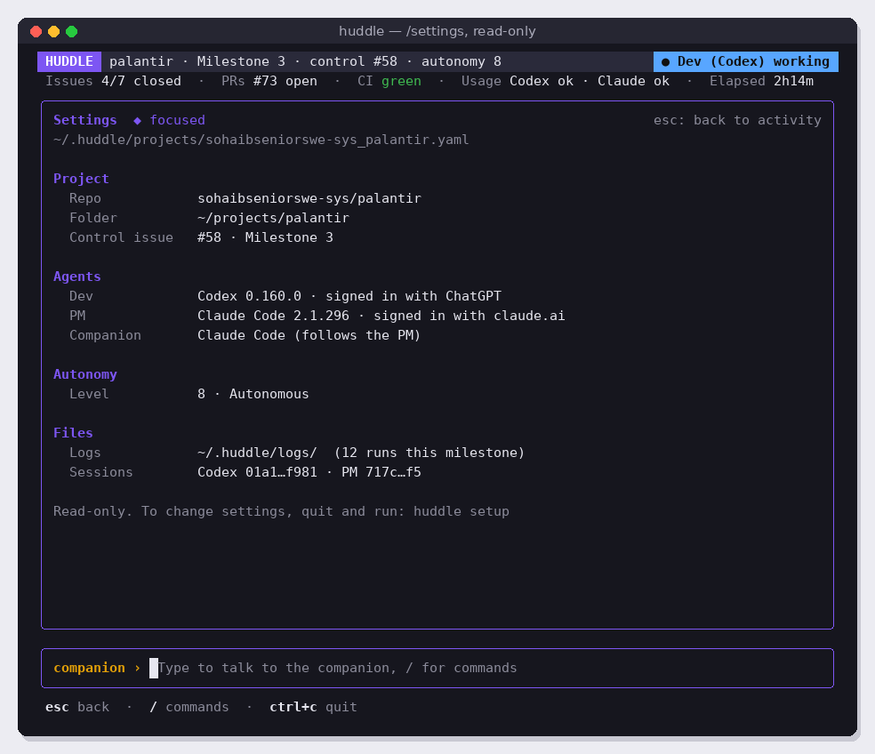
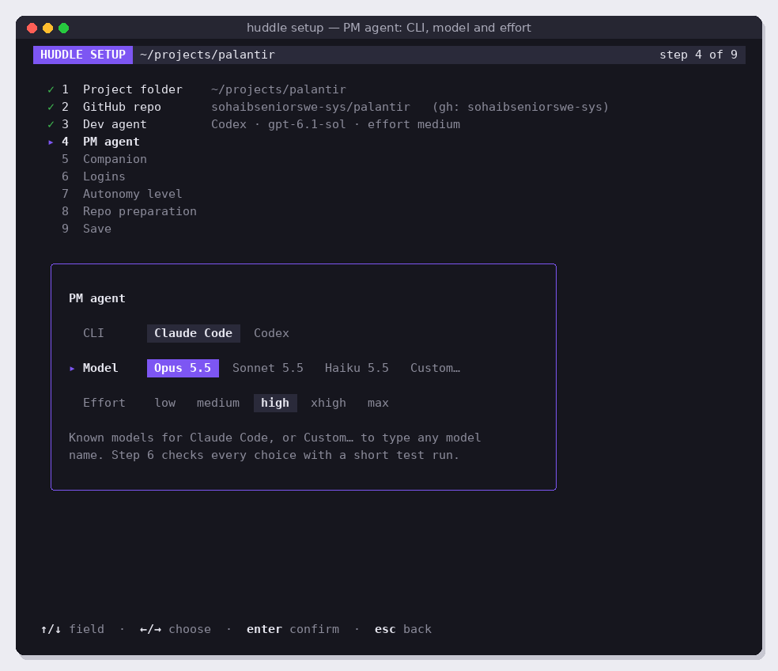

# v3.3 Agent choice and config

Let any of the three roles (Dev, PM, companion) be played by Codex or Claude Code, each with its own model and effort, stored in a per-project config file and shown read-only in `/settings`. Depends on v3.1.

Read [README.md](../README.md) (especially "Verified facts about the agent CLIs") and [coding-guidelines.md](../coding-guidelines.md) first.

## Screens

`/settings`, read-only, in the Activity slot:



The wizard (v3.4) will edit what this issue stores; its screens show the choices this issue must support:



## What to build

### 1. Config file (`internal/config`)

One YAML file per project: `~/.huddle/projects/<owner>_<repo>.yaml`. Use `gopkg.in/yaml.v3`.

```yaml
# Written by `huddle setup`. Safe to edit by hand.
repo: sohaibseniorswe-sys/palantir
dir: /home/sweeng/projects/palantir
agents:
  dev:
    cli: codex          # codex | claude
    model: gpt-6.1-sol  # empty = the CLI's own default
    effort: medium      # empty = the CLI's own default
  pm:
    cli: claude
    model: opus
    effort: high
  companion:
    same_as_pm: false   # true = use the PM's cli, model and effort
    cli: claude
    model: sonnet
    effort: medium
autonomy: 8             # used from v3.5
```

- `Load(repo)` returns defaults when the file does not exist: Dev = Codex, PM = Claude Code, companion same as PM, CLI default model and effort, autonomy 8. This keeps today's behaviour until the wizard exists.
- `Save` writes atomically (write a temp file, then rename) and keeps the comment header.
- `Validate` returns clear errors: unknown CLI, effort not valid for that CLI, autonomy outside 0–10.

### 2. Agent table (`internal/agents`)

One small, readable description per CLI, in one file, replacing the hardcoded commands from v1:

```go
// CLI describes one agent command-line tool and how Huddle drives it.
type CLI struct {
	Name          string   // "Codex" or "Claude Code", shown in the UI
	ID            string   // "codex" or "claude", stored in the config
	Binary        string   // executable name
	KnownModels   []Model  // offered by the wizard; Custom… allows any name
	Efforts       []string // valid effort levels, in order
	DefaultEffort string
}

// Model is one entry in the wizard's model list.
type Model struct {
	Label string // shown, e.g. "Opus 5.5"
	Value string // passed to the CLI, e.g. "opus"
}
```

Plus plain functions (no interfaces with one implementation) that build the fresh and resume commands for a role from `(cli, model, effort)`:

| | Codex | Claude Code |
| --- | --- | --- |
| Model | `-m <model>` | `--model <model>` |
| Effort | `-c model_reasoning_effort="<effort>"` | `--effort <effort>` |
| Efforts | `none`, `low`, `medium`, `high`, `xhigh` | `low`, `medium`, `high`, `xhigh`, `max` |
| Known models (starting list) | `gpt-6.1-sol` | `opus` (Opus 5.5), `sonnet` (Sonnet 5.5), `haiku` (Haiku 5.5) |

- Re-check every flag against `--help` of the installed versions and record versions in the README. Empty model or effort means the flag is left out.
- Claude Code's aliases (`opus`, `sonnet`, `haiku`) follow the newest model, so they stay valid. Label them with the version current at implementation time.
- Neither CLI can list its models (see README), so the known lists are a starting point only. Keep them in one clearly commented place so they're easy to update.
- Codex prints its active model in its header (`model: …`). Record it from real runs and show it in `/settings`, so the user can see which model "CLI default" resolved to.
- Usage-limit detection, session ids and final-message extraction from v1 move into this package, per CLI, unchanged.

### 3. Validation run

```go
// Validate checks that cli can run with model and effort by sending a
// tiny prompt ("Reply with the word OK") and checking the answer.
func Validate(ctx context.Context, cli CLI, model, effort string) error
```

- Returns a readable error the wizard can show: "Claude Code rejected model "opux": unknown model", "effort xhigh is not available for this model", "not signed in", or the CLI's own message.
- Uses the subscription; never an API key (the existing guard still applies).
- Times out after 2 minutes.

### 4. Roles are independent of the CLI

- The operating principles name roles, not tools: "YOUR ROLE: DEV" and "YOUR ROLE: PM", with the agent's name filled in ("You are the Dev agent (Claude Code)").
- Labels, prompts, sessions, usage waits and escalation work the same whichever CLI plays a role.
- The status bar and Activity show the real tool: `Dev (Claude) working`, actor `claude`.

### 5. `/settings`

A read-only view in the Activity slot (screen 09): config file path, repo, folder, control issue, each role's CLI, version, login type, model and effort, autonomy, log folder, session ids. Footer: "Read-only. To change settings, quit and run: huddle setup". Esc returns to Activity.

### 6. macOS

Add `macos-latest` next to `ubuntu-latest` in CI. Fix anything Unix-specific that differs on macOS (paths, `ps`, signals). Note the result in the README.

## Out of scope

The wizard UI (v3.4). Swapping roles automatically on a usage limit.

## Success criteria

- [ ] Config tests: load defaults, load file, save and reload, invalid CLI, invalid effort per CLI, autonomy out of range.
- [ ] Command-building tests for every role × CLI combination, with and without model and effort.
- [ ] `Validate` tests with fake CLIs: success, unknown model, bad effort, not signed in, timeout.
- [ ] Sandbox run with roles swapped (Claude Code as Dev, Codex as PM) reaches `state:done`.
- [ ] Sandbox run with a non-default model and effort for each role; the log shows the flags were passed.
- [ ] `/settings` matches screen 09 (golden test).
- [ ] CI passes on Linux and macOS.
- [ ] Code follows [coding-guidelines.md](../coding-guidelines.md).
