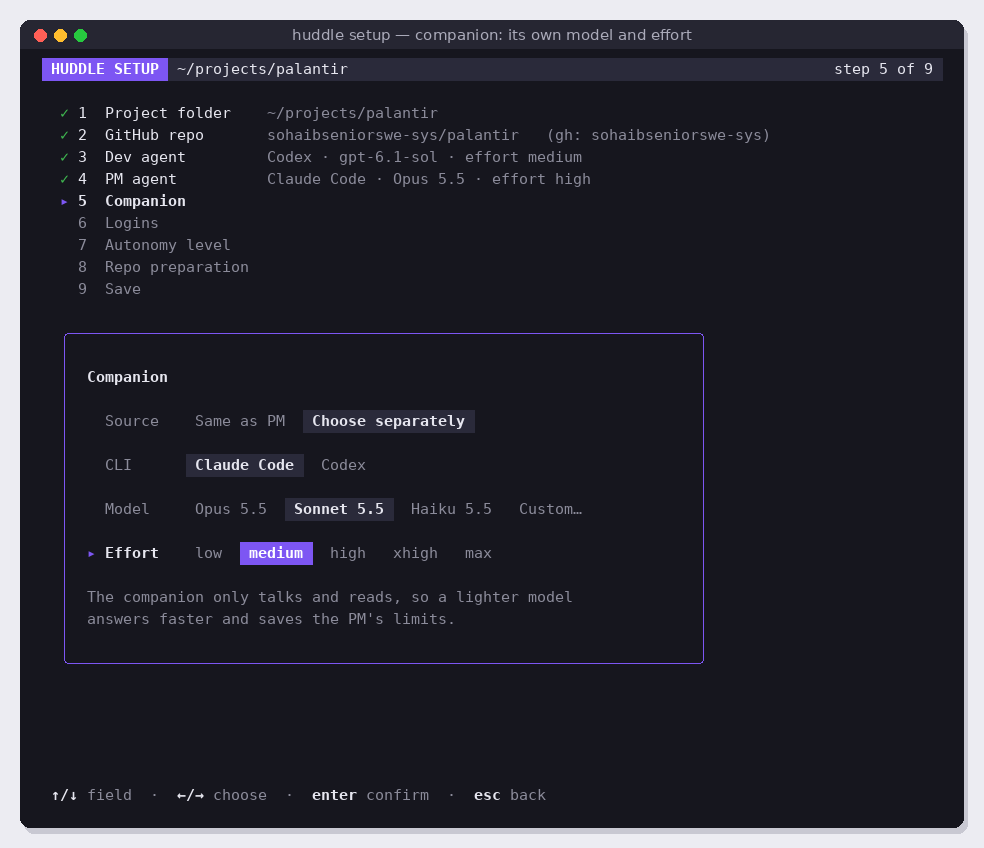

# v3.4 Setup wizard

Replace all the manual v1 setup with a nine-step wizard that runs the first time Huddle is used in a project (and again with `huddle setup`), and writes the config file from v3.3. Depends on v3.3.

Read [README.md](../README.md) and [coding-guidelines.md](../coding-guidelines.md) first.

## Screens

## What to build

A Bubble Tea model in `internal/wizard`. The left column always lists the nine steps: done steps show ✓ and their value, the current step shows ▸, later steps are dimmed. The current step's card sits below. Detected or current values are pre-selected.

| # | Step | What it asks or does |
| --- | --- | --- |
| 1 | Project folder | Detects the git repo in the current directory. If there is none, a `textinput` asks for a folder and checks it. |
| 2 | GitHub repo | Reads `origin`, shows `owner/repo` and the `gh` account, checks read and write access (as v1's startup checks do). |
| 3 | Dev agent | CLI, model, effort (chips; see screen 11). |
| 4 | PM agent | CLI, model, effort. Note under the card: either CLI can play either role; Codex as PM saves Claude Code's limits. |
| 5 | Companion | "Same as PM" or "Choose separately", then CLI, model, effort (screen 12). |
| 6 | Logins and test runs | For each distinct CLI: installed, version, subscription login (v1 checks), no API keys. Then runs `agents.Validate` for each role's CLI, model and effort, one row per role with a spinner, then ✓ or the error. On an error, Enter goes back to that role's step. |
| 7 | Autonomy level | The dial, 0–10, default 8, with the row for the chosen level shown in words (screen 13). |
| 8 | Repo preparation | Creates missing labels. Checks AGENTS.md and CLAUDE.md; offers to create starter versions (embedded templates, shown before writing). Warns, without blocking, if AGENTS.md contains rules that fight the chosen autonomy (at 6 or above: "never push", "do not merge", "ask before", "wait for approval"), with line numbers. |
| 9 | Save | Shows a summary, writes the config (v3.3), and offers to commit the new agent files. |

Choosing a model:

- Chips for the CLI's known models (from the v3.3 agent table) plus **Custom…**, which opens a `textinput` for any model name.
- Effort chips come from the CLI's valid efforts; when the CLI changes, reset effort to that CLI's default.
- A note under the card says the choices are checked in step 6.

Keys: ↑/↓ move between fields, ←/→ change a chip, Enter confirms the step, Esc goes back one step, Ctrl+C quits without saving. Mouse: click a chip to select it.

When it runs:

- No config file for this repo: the wizard runs before anything else.
- `huddle setup`: runs with the current config pre-selected.
- `huddle --plain` with no config: print "Run huddle setup first" and exit with status 2 (the wizard needs a terminal).

## Out of scope

Start menu (v3.6). Editing settings from inside the run screen.

## Success criteria

- [ ] On a fresh clone with no config, `huddle` opens the wizard; after step 9 the config file exists and the next `huddle` skips the wizard.
- [ ] `huddle setup` pre-selects every current value.
- [ ] Screens 11, 12 and 13 match at 100 × 34 (golden tests).
- [ ] Step 6 shows a real validation error for a bad custom model name (fake CLI test) and Enter returns to that role's step.
- [ ] Changing a role's CLI resets its effort to a valid default (Update test).
- [ ] Step 8 finds conflicting AGENTS.md rules at autonomy 8 and not at autonomy 3 (test with sample files).
- [ ] Esc at every step goes back one step without losing choices.
- [ ] Manual check: set up the sandbox from scratch with the wizard only, then run a Sandbox milestone to `state:done`.
- [ ] Code follows [coding-guidelines.md](../coding-guidelines.md).
