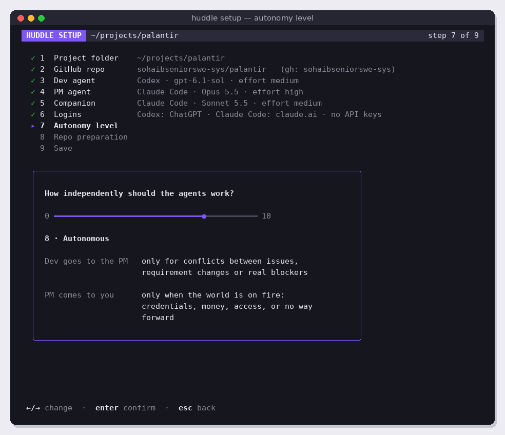

# v3.5 Autonomy level

Give every agent one autonomy level from 0 (most careful) to 10 (most independent), with the full table, so each knows exactly when to hand over. Depends on v3.3.

Read [README.md](../README.md) and [coding-guidelines.md](../coding-guidelines.md) first.

## Screens



## Why

In Sandbox M2, with no level in its instructions, Codex settled a conflict between two issues on its own and the PM accepted it without question: that is level 9–10 behaviour. At the default level 8, a conflict between issues must go to the PM. The fix is not a special rule but telling every agent its level and what each level means.

## What to build

### 1. One dial

- `autonomy` in the config (v3.3), default 8, validated 0–10.
- A `--autonomy N` flag overrides the config for one run.
- If v1 still has separate `--dev-autonomy` / `--pm-autonomy` flags, replace them with this single dial.
- Shown in the status bar ("autonomy 8"), `/status` and `/settings`.

### 2. The AUTONOMY section

Add this section to the shared operating principles, right after HOW HUDDLE WORKS, word for word, filling in the level:

```
AUTONOMY
Huddle runs at autonomy level {{level}}, on a scale from 0 (most careful) to 10 (most independent). Apply the row for that level to your own role.
Dev, when to hand over to the PM:
- 0-2 Supervised: after every issue, and before every push or merge, so the PM reviews each change.
- 3-5 Checkpoints: after every issue; make small technical choices yourself.
- 6-8 Autonomous: only for conflicts between issues, requirement changes, or real blockers; decide everything technical yourself.
- 9-10 Full autonomy: only when completely blocked or done; settle even conflicts yourself and record why.
PM, when to come to the human:
- 0-2 Supervised: for every product decision and before each merge.
- 3-5 Checkpoints: for product decisions; approve merges yourself.
- 6-8 Autonomous: only when the world is on fire: credentials, money, access, or no way forward.
- 9-10 Full autonomy: only for credentials or money.
```

### 3. Role sections

- Each role section starts with "You are the Dev agent ({{cli}}), working at autonomy level {{level}}." or "You are the PM agent ({{cli}}), working at autonomy level {{level}}."
- Remove every other sentence in the role sections that says when to hand over or escalate, so the AUTONOMY table is the only rule and nothing contradicts it at other levels.
- The companion's context block (v3.2) includes the level, so it can explain the agents' behaviour.

### 4. Calibration

Create a sandbox milestone designed to test the levels, with:

1. one ordinary issue,
2. two issues that contradict each other,
3. one issue with a small technical ambiguity,
4. one issue only the human can complete.

Run it at levels 3, 8 and 10 (reset the sandbox between runs) and record the results in `docs/v3/autonomy-calibration.md`. Expected:

| Level | Conflict (2) | Ambiguity (3) | Human-only (4) |
| --- | --- | --- | --- |
| 3 | Dev hands over after each issue; conflict goes to the PM; PM asks the human | Dev decides | Ends at `state:human-required` |
| 8 | Dev finishes the rest, hands the conflict to the PM; PM decides itself | Dev decides | Ends at `state:human-required` |
| 10 | Dev settles it itself and records why | Dev decides | Ends at `state:human-required` |

If an agent clearly ignores its row, adjust the wording of the section (not the table's meaning) and rerun.

## Success criteria

- [ ] Golden tests of the rendered principles at levels 0, 3, 8 and 10, for both roles and both CLIs.
- [ ] A test that the old handover rules are gone from the role sections: the phrases "Hand over to the PM (state:pm-ready) only when" and "Set state:human-required at any other time only when" no longer appear. (Instructions about labels at the end of a milestone, such as the PM's final report, stay.)
- [ ] `--autonomy` overrides the config; values outside 0–10 are rejected with a clear message.
- [ ] Calibration done at 3, 8 and 10, with results and any wording changes recorded in `docs/v3/autonomy-calibration.md`. At level 8 the conflict goes to the PM.
- [ ] Code follows [coding-guidelines.md](../coding-guidelines.md).
