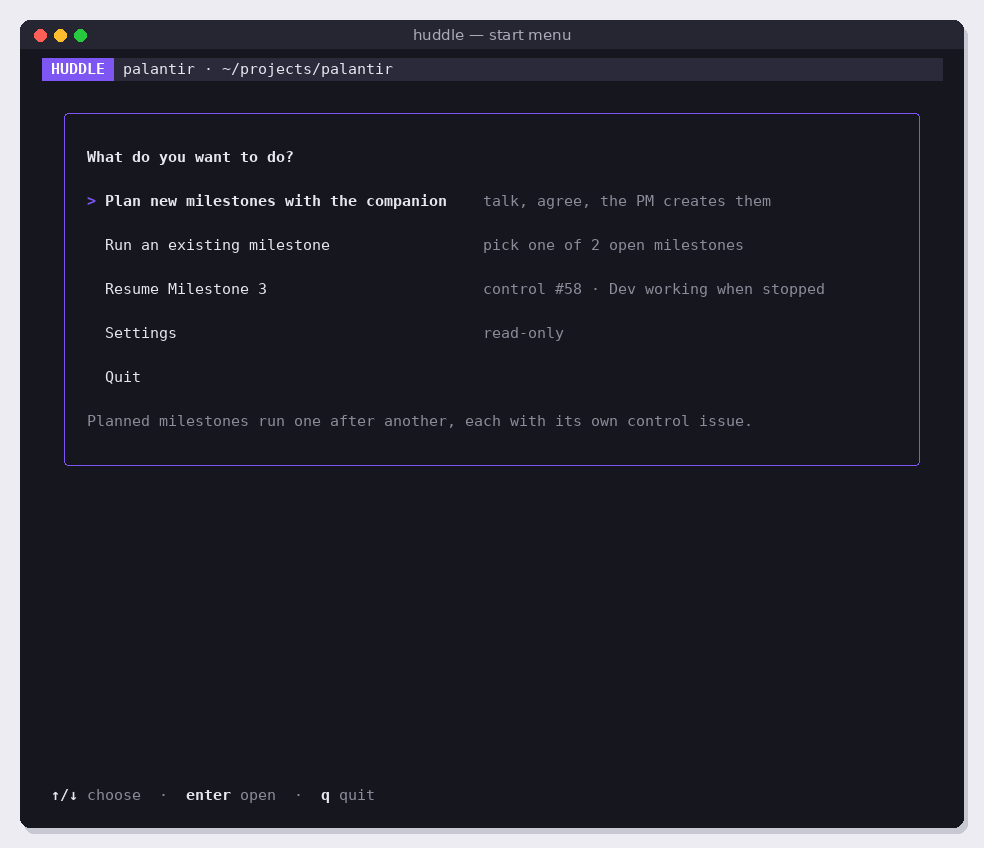
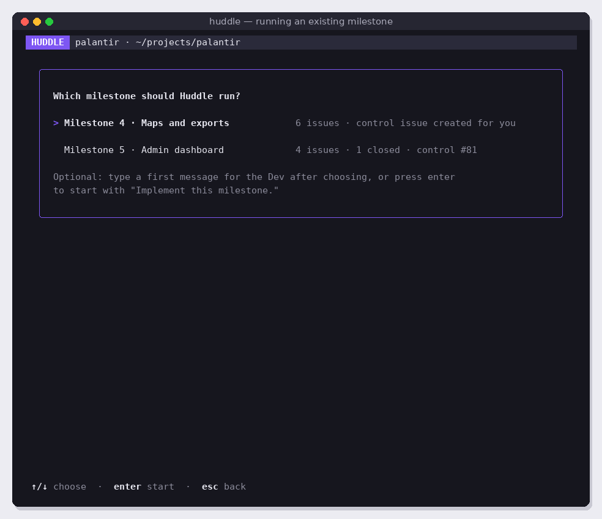
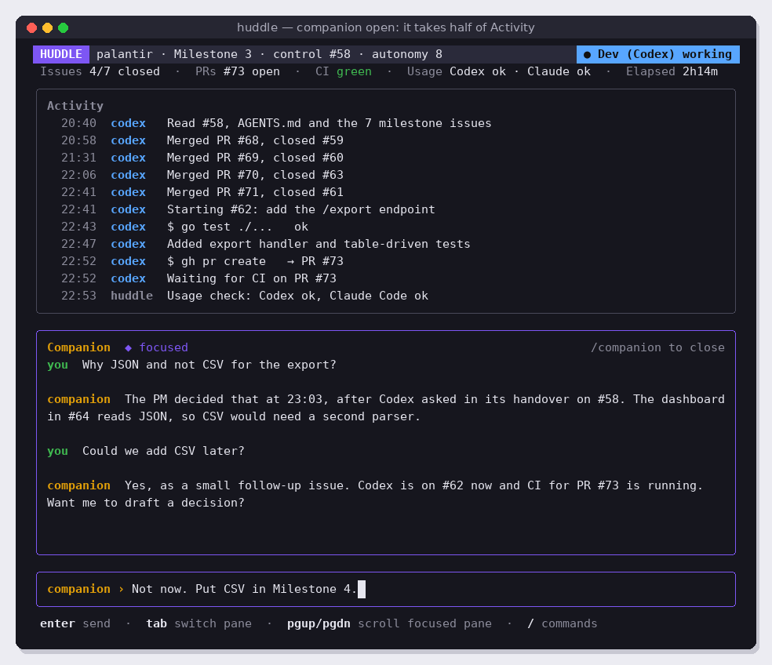
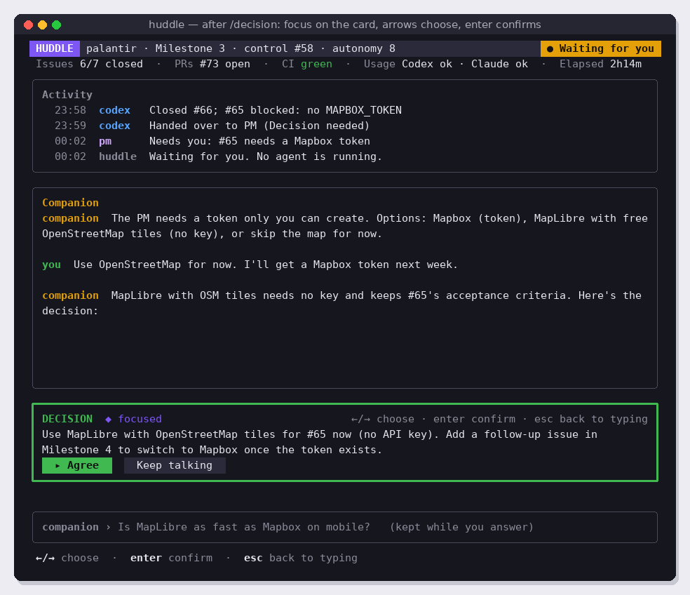

# v3.6 Start modes

Open Huddle on a start menu: plan new milestones by talking to the companion, run a milestone that already exists, or resume one that was interrupted. Planned milestones run one after another without the human. Depends on v3.2 and v3.4.

Read [README.md](../README.md) and [coding-guidelines.md](../coding-guidelines.md) first.

## Screens

The start menu (shown after the wizard, or straight away once configured):



Running an existing milestone:



Planning happens in the normal run screen with the Companion pane open, and ends with a decision card:





## What to build

### 1. Start menu (`internal/start`)

| Option | Shown when | Does |
| --- | --- | --- |
| Plan new milestones with the companion | always | Opens plan mode |
| Run an existing milestone | the repo has open milestones | Opens the milestone picker |
| Resume Milestone N | an open control issue has a `state:*-working`, `-ready` or `human-required` label | Opens the run screen and resumes, as v1 does on startup |
| Settings | always | The read-only settings view (v3.3) |
| Quit | always | Exits |

↑/↓ choose, Enter opens, `q` or Esc quits. `huddle --resume`, `huddle --run "<milestone title>"` and `huddle --plan` skip the menu.

### 2. Run an existing milestone

- List open milestones with `gh api repos/{owner}/{repo}/milestones?state=open`, with issue counts and the control issue if one exists.
- If the chosen milestone has no control issue, create one (title "<milestone> Control", label `control`, body with "## First Dev task" and "Prompt: Implement this milestone.").
- After choosing, the text field offers an optional first message for the Dev. If given, it goes into the control issue body's First Dev task instead of the default prompt.
- Set `state:dev-ready` and open the run screen.

### 3. Plan mode

Plan mode is the run screen with the Companion pane open and no milestone running yet. The project pane shows "Planning" instead of a milestone.

1. You talk to the companion. You can start with an open question ("what should we do next?") or with decisions already made ("I've decided these milestones: … create them with their issues and a control issue, then hand over to the Dev").
2. The companion can read the repo, its issues, past milestones and control issues, and research.
3. When the plan is agreed, the companion writes it as a `<plan>` block instead of a decision:

   ```
   <plan>
   milestone: Milestone 4 · Maps and exports
   description: ...
   issue: Add the /export endpoint
   body: ... acceptance criteria ...
   issue: ...
   milestone: Milestone 5 · ...
   ...
   </plan>
   ```

   Define this format precisely in the companion's planning instructions and parse it in Go with a simple line-based parser (no YAML or JSON inside the tags; agents get those wrong more often than a few `key: value` lines).
4. Huddle shows the plan in the card slot as a summary ("2 milestones, 9 issues"), with **Agree**, **Show all** (opens the full plan in the Activity slot) and **Keep talking**. Same focus rules as decision cards (`/decision`).
5. On Agree, Huddle itself creates the milestones, issues and control issues with `gh`, in order. Huddle does this, not the PM, because it is mechanical and must not be interpreted. Each step appears in Activity.
6. Huddle adds the control issues to the **milestone queue** and starts the first one with `state:dev-ready`.

### 4. Milestone queue

- `~/.huddle/queue/<owner>_<repo>.json`: an ordered list of control issue numbers.
- When a milestone reaches `state:done`, Huddle prints its final report in Activity and starts the next control issue in the queue, without asking.
- When the queue is empty, the badge shows `Done` and the start menu returns on the next key press.
- If a milestone ends in `state:human-required`, the queue waits (the run screen is already showing the companion).
- `/status` shows the queue: current milestone and the ones waiting.

## Out of scope

Running two milestones at the same time. Editing a plan after it was agreed (talk to the companion and agree a new plan instead).

## Success criteria

- [ ] Screens 14 and 15 match at 100 × 34 (golden tests).
- [ ] Plan parser tests: one milestone, several milestones, an issue body over several lines, missing fields (clear error shown to the user, nothing created), text outside the block ignored.
- [ ] Agreeing a plan creates exactly the milestones, issues and control issues in it, in order (fake GitHub test), and queues them.
- [ ] The queue starts the next milestone automatically after `state:done` (fake runner test) and survives a Huddle restart.
- [ ] Running an existing milestone without a control issue creates one; with an optional first message, that message is the First Dev task.
- [ ] End to end in the sandbox: plan two small milestones with the companion, agree, and both run to `state:done` one after the other with nobody touching anything.
- [ ] Code follows [coding-guidelines.md](../coding-guidelines.md).
